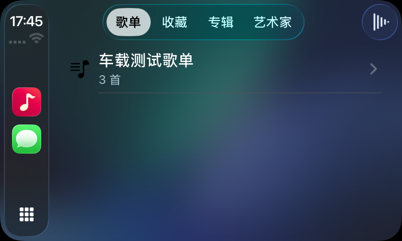
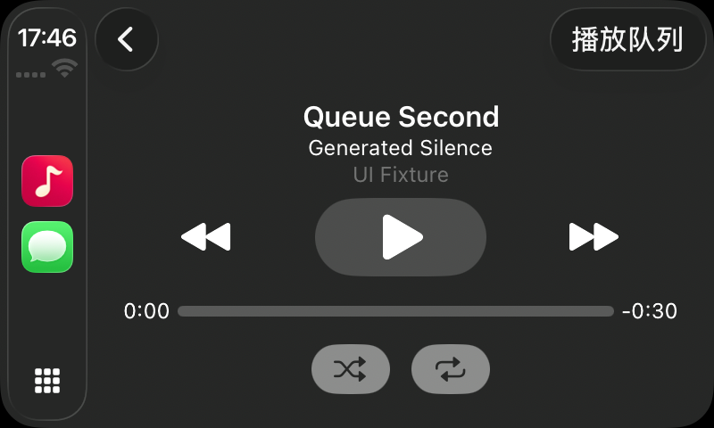

# CarPlay 首版

> 当前范围（2026-11-05）：CarPlay 授权与实车测试、长时间播放、最低系统兼容性专项验证及采样级无缝录音验证已移出当前需求和发布门槛，运营阶段按需评估。本页保留历史记录及后续参考步骤，不形成当前待办。详见[范围决策](./decisions/2026-11-05-release-scope.md)。

更新：2026-11-04。最低系统仍为 iOS 17；macOS 使用原有原生界面。

## 当前能力

车载界面使用 Apple CarPlay 模板，提供歌单、收藏、专辑、艺术家四个标签。可浏览曲目、顺序或随机播放整组音乐、选择单曲，以及从系统“正在播放”页面暂停、继续、切换上下首、切换随机与循环。右上角“播放队列”显示当前条目与待播条目，可直接选择其中一项。

车载与手机共享同一个 `PlayerStore`，不创建第二套播放器或队列。手机修改收藏、歌单或队列时，连接中的车载列表会刷新。队列中同一首歌的不同条目通过独立 ID 识别。

长列表按页展示，保留上一页／下一页入口，每页数量受系统模板最大条目数约束。翻页更新当前模板，不持续压入导航栈。队列选择返回已有的“正在播放”模板，避免反复打开同一个模板耗尽导航层级。

空音乐库／空歌单会提示先在 iPhone 导入或整理歌曲。用户操作前会重新解析当前音乐库与歌单，已经移除的内容不会通过旧列表重新播放。文件丢失时使用车载提示，下一首沿用已有的有界跳过逻辑。

## 启动与连接

`AppSession` 统一管理一次启动任务；手机窗口和 `CPTemplateApplicationSceneDelegate` 都等待这项任务。不要求手机页面先运行，冷启动可读取本地音乐库、歌单及暂停的播放快照。连接与重连不主动播放。

车载场景断开时暂停并保存进度，避免切回扬声器继续外放。暂停会释放 iOS 音频会话并通知其他音频应用。正在播放信息包含标题、艺术家、专辑、封面（存在内嵌图片时）、时长、进度、播放速率和队列位置；系统模式命令与应用的随机／循环状态同步。

数据库、已有 SQLite 附属文件、媒体目录与导入音频配置为 `completeUntilFirstUserAuthentication`。初次安装或升级后先在已解锁状态打开一次，完成本地配置。设备重启后仍需先解锁一次；首次解锁后再锁屏可以读取这些资源。模拟器不提供与真机等价的文件保护和锁屏行为，相关属性检查单独在真机执行。

## 工程与签名

仓库提供两个共享 scheme：

| Scheme | 用途 |
| --- | --- |
| `Zuneyra` | 常规手机／Mac 开发；保留现有 iPhone 签名方式。iOS 模拟器构建包含 CarPlay entitlement 以便测试。 |
| `Zuneyra-CarPlay` | `CarPlay Debug`／`CarPlay Release` 配置；iOS 真机与模拟器均要求 `com.apple.developer.carplay-audio`。获批后用于车载开发和归档。 |

`Configuration/AppInfo.plist` 显式注册音频 CarPlay 场景，关闭自动场景清单生成，避免构建时覆盖自定义场景。普通窗口仍由 SwiftUI 管理。macOS 的签名继续使用独立的 `Mac.entitlements`。

当前本机用于安装的 provisioning profile **不包含 CarPlay Audio**。使用 `Zuneyra-CarPlay` 构建连接的 iPhone 时，签名检查提示该 entitlement 无法加入 profile。该问题需要开发者账号获得并配置 Apple 的受管理能力；不能通过只在 plist 中写一个键解决。

申请步骤和可编辑说明见 [CarPlay 权限申请准备](./carplay-entitlement-request.md)。获批并为明确的 App ID 生成 profile 后，在 CarPlay 配置的 Signing & Capabilities 中选择对应团队、证书和包含权限的 profile，再构建或归档。未授权时不要以常规手机 scheme 的安装成功作为 CarPlay 真机可用的证据。

## 本地复验

在 Xcode 选择 `Zuneyra-CarPlay` 和 iOS 模拟器运行；然后在 Simulator 的 I/O → External Displays → CarPlay 打开车载窗口。点击车载主屏上的 Zuneyra。命令行也可构建：

```sh
xcodebuild -project Zuneyra.xcodeproj -scheme Zuneyra-CarPlay \
  -destination 'platform=iOS Simulator,name=iPhone 17 Pro' \
  CODE_SIGN_IDENTITY=- build
```

使用正常启动的应用，手动导入可用于验收的音频，并创建歌单和收藏。专用演示启动模式已移除，不再自动生成测试音乐库。

建议依次检查：歌单／收藏／专辑／艺术家浏览 → 选曲 → 系统正在播放 → 上下首与暂停／继续 → 随机／循环 → 队列选曲返回正在播放 → 断开时暂停 → 重连不自动播放 → 不可用文件提示。实车还需检查锁屏冷启动、车机按键、导航提示、来电中断、有线和无线连接及路由切换。

## 历史验证记录

以下记录来自 2026-11-04，使用 Xcode 26.6。当前仅保留 `ZuneyraTests`，界面与车机交互采用手动验收：

| 环境 | 结果 |
| --- | --- |
| iOS 26.5 / iPhone 17 Pro 模拟器 | 当时的 48 项核心测试通过。 |
| macOS / Apple Silicon | 当时的 46 项核心测试通过。 |
| iPhone 15 / iOS 26.6.1 | 目录、启动、场景清单与文件保护检查共 6 项通过；这是普通 iPhone 测试，不是实车测试。 |
| CarPlay Release / iOS 模拟器 | Release 编译通过。 |
| CarPlay 专用 scheme / iPhone | 签名被当前 profile 缺少 CarPlay Audio 阻挡；真实车机验收待获批并配置 profile 后进行。 |

模拟器手工验证已检查四类浏览、歌单发起播放、系统上下首、随机／循环、队列选曲返回已有播放器、断开暂停、重连不自动播放，以及缺失文件的车载提示。还检查了仅从车机图标冷启动空音乐库，此时手机仍停留在主屏；非空音乐库的独立启动与并发启动由 `ZuneyraTests` 中的启动组件测试覆盖。

模拟器不能替代实车的实际发声、锁屏、车机按键、导航提示及无线连接验收；本轮未将这些场景标记为通过。

### 模拟器预览

以下为此前验收保留的截图，使用当时隔离生成的测试音乐库，不包含用户音乐：





## Apple 依据

- [Requesting CarPlay Entitlements](https://developer.apple.com/documentation/carplay/requesting-carplay-entitlements)：受管理权限申请、App ID 和 profile 配置。
- [Using the CarPlay Simulator](https://developer.apple.com/documentation/carplay/using-the-carplay-simulator)：外接显示入口、模拟器限制与实车验证建议。
- [Integrating CarPlay with Your Music App](https://developer.apple.com/documentation/carplay/integrating-carplay-with-your-music-app)：音频应用的列表与正在播放模板。

本次 API 实现另核对 Xcode 26.6 所带 CarPlay／MediaPlayer SDK 声明。
