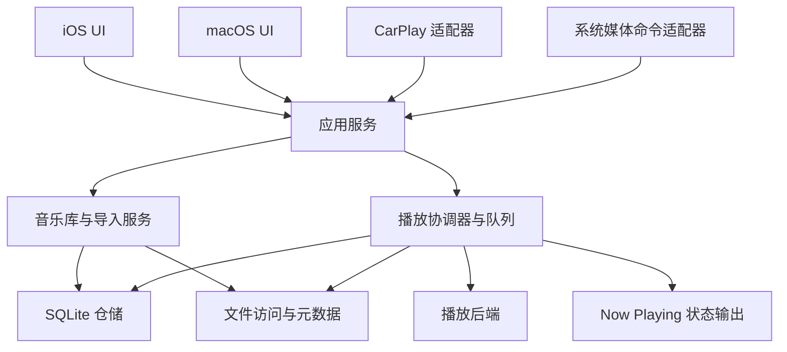

# Zuneyra 产品与技术设计文档

| 项目 | 内容 |
| --- | --- |
| 版本 | v0.1 |
| 日期 | 2026-11-04（Asia/Singapore） |
| 状态 | 初始设计基线，供产品、开发和测试使用 |
| 产品 | 面向个人音乐收藏的专业离线音乐播放器 |
| 平台 | iOS、原生 macOS、CarPlay |
| 核心原则 | 离线可用、播放可靠、音乐库可控、平台体验自然 |

本文包含产品方案与工程设计。除“现有工程”外，均描述计划实现的行为；性能数字为待验证目标。默认决策允许开始开发，带有验证门槛的项目必须在对应里程碑取得实测证据后才能对外承诺。

## 1. 产品愿景与边界

### 1.1 产品定位

Zuneyra 帮助用户整理和聆听自己拥有的音乐文件。用户在 iPhone 上随身聆听，在 Mac 上管理较大的收藏，在车内通过 CarPlay 安全地浏览和控制同一部 iPhone 的本地音乐。

“离线”意味着已成功导入的托管音乐无需网络、登录、服务端授权或远程封面请求即可浏览与播放。Mac 引用的外置磁盘音乐以磁盘保持连接为前提。第三方文件提供器中的文件只有完成本地复制后，才能被标记为离线可用。

“专业”体现为稳定的队列与状态恢复、准确的专辑与标签呈现、无缝播放验证、文件生命周期清晰、较大音乐库下的响应速度，以及对播放中断和设备变化的可靠处理。

### 1.2 目标用户与主要场景

| 用户／场景 | 核心需求 | 成功标准 |
| --- | --- | --- |
| 本地音乐收藏者 | 保存 MP3、AAC、无损专辑，按专辑聆听 | 标签、封面、碟号和曲序正确 |
| 日常通勤者 | 锁屏和后台播放、耳机控制 | 切换应用不停止，断开耳机不突然外放 |
| Mac 音乐库管理者 | 导入文件夹、搜索、批量加入歌单 | 不强制复制整个外部音乐库，失联后可重新定位 |
| 驾驶者 | 收藏、歌单、最近播放、正在播放 | 无需在车上处理授权、导入或复杂编辑 |
| 无网络环境用户 | 在飞行模式、弱网地区播放 | 托管音乐的浏览、搜索、播放完全可用 |

### 1.3 默认产品决策

- 首版无需账号，不提供广告和第三方行为分析 SDK。
- iPhone 与 Mac 各自维护本地音乐库；共享代码不代表音乐文件自动跨设备同步。
- iOS 默认将导入文件复制到应用管理的持久存储；macOS 默认引用用户授权的本地文件夹，也提供复制导入。
- iOS 与 macOS 使用平台适配的 SwiftUI 界面；CarPlay 使用系统模板。
- 简体中文、英文作为首版语言；内容标签保留原语言。
- iPad 使用自适应分栏，纳入基础布局验证，专门的大屏工作流后续深化。
- 商业模式尚未确定，不将付费校验引入首版播放核心。

### 1.4 首版不包含

流媒体目录、从其他音乐服务提取或解密文件、账号体系、社区、云端音乐上传、跨设备自动同步、NAS／SMB／WebDAV 浏览、在线歌词与封面抓取、音频标签写回原文件、视频、DSD／APE／WavPack、专业音频独占输出与 bit-perfect 承诺。

允许通过系统“文件”选择器选择云端文件，但导入可能需要文件提供器联网下载。应用必须说明“正在获取文件”，不能把尚未下载的项目显示为已离线保存。

## 2. 现有工程与平台策略

### 2.1 现有工程快照

根据 2026-11-04 对工程文件的检查：

- `Zuneyra/ContentView.swift` 为 SwiftUI 默认欢迎页。
- `Zuneyra/ZuneyraApp.swift` 只有基础 `WindowGroup`。
- 初始工程包含主应用和测试 target；当前测试范围已收敛为 `ZuneyraTests`，不再保留 UI 测试 target。
- 工程配置使用 iPhoneOS SDK，iOS deployment target 为 26.5，设备族包含 iPhone 与 iPad。
- Swift 语言模式为 5.0，并启用了默认 MainActor 隔离相关设置。
- 尚未实现播放、持久化、导入、系统媒体控制和 CarPlay。

本文不会直接修改这些构建设置。实现前需确认本机 SDK、签名配置以及目标系统上的 API 可用性。

### 2.2 推荐支持范围

| 项目 | 设计基线 | 说明 |
| --- | --- | --- |
| iOS／iPadOS | 建议最低 iOS 17 | 当前工程是 26.5，降低版本需独立构建与真机验证 |
| macOS | 建议最低 macOS 14，原生应用 | 优先验证 Apple Silicon；Intel 发布支持取决于构建和测试资源 |
| CarPlay | 随 iOS 应用提供 | 使用同一 iPhone 的数据库、文件和播放器 |
| 构建工具 | 实施时可用的稳定版 Xcode | 将具体版本记入 CI 与发布记录 |

最低系统版本属于拟定产品决策。使用较新 API 时必须提供可用性判断和兼容路径；不能为了装饰效果隐式提升整个应用的最低版本。

### 2.3 平台分工

| 能力 | iOS | macOS | CarPlay |
| --- | --- | --- | --- |
| 文件导入 | 系统文件选择、多选、批量复制 | 文件／文件夹选择、拖放、复制或引用 | 不提供 |
| 音乐库 | 歌曲、专辑、艺术家、歌单、收藏 | 相同内容，加文件夹与表格视图 | 收藏、歌单、最近播放、专辑入口 |
| 播放控制 | 完整 | 完整，含菜单和快捷键 | 系统允许的车载控制 |
| 歌词与详细信息 | 支持 | 支持 | 不呈现滚动歌词与复杂技术信息 |
| 管理 | 基础批量操作 | 批量操作、源文件夹状态 | 不提供编辑和删除 |
| 恢复 | 恢复队列与位置 | 恢复队列与位置 | 展示并操作 iPhone 当前会话 |

## 3. 范围、优先级与发布门槛

MVP 是内部可日常使用的版本，1.0 是对外发布版本。CarPlay 属于 1.0 目标，其授权和真机验收是独立门槛。

| 能力 | MVP 必须 | 1.0 必须 | 后续 |
| --- | --- | --- | --- |
| MP3、AAC/M4A、ALAC、WAV、AIFF 本地播放 | 是，按测试样本定义支持范围 | 是 | 扩展编码变体 |
| FLAC | M0 验证解码、标签和 seek | 是；不通过则先解决后发布承诺 | 更多位深／声道组合 |
| 导入、封面、标签、专辑、艺术家、搜索 | 是 | 是 | 高级标签编辑 |
| 歌单、收藏、顺序／随机／循环 | 是 | 是 | 智能歌单 |
| 后台、锁屏、耳机控制、播放恢复 | 是 | 是 | 快捷指令／更多系统入口 |
| Mac 引用文件夹与重新授权 | 是 | 是 | 更高级的实时目录监听 |
| 同格式专辑无缝播放 | 技术验证 | 已声明支持的组合必须通过 | 跨格式的更多组合 |
| 本地 LRC／内嵌歌词 | 可延后 | 是 | 高级歌词编辑 |
| ReplayGain | 预留元数据字段 | 读取并应用已有增益标签 | 本地响度分析、EQ、交叉淡化 |
| CarPlay | 原型与授权准备 | 授权、集成、真机验证通过 | 更多系统允许的入口 |
| 备份导出／恢复、M3U8 导入导出 | 可延后 | 是 | 设备间传输与同步 |

首版发布不能将未实现项包装成现有能力。若 CarPlay 授权影响发布时间，可发布明确标注仅支持 iOS／macOS 的版本，但不能宣称三平台已完成。

## 4. 信息架构与交互设计

### 4.1 视觉与交互原则

以专辑封面和内容层级为视觉中心，采用系统字体、系统图标、浅色与深色主题。主要播放操作始终容易触达；导入、删除、源文件授权等管理动作不占据播放主界面。

正文、标题、次级信息使用语义字体；状态不能只靠颜色表达。封面缺失时使用稳定的占位图，不联网补全。封面主色仅用于有限的背景或强调色，文字仍须保持可读对比度。

### 4.2 iPhone 导航

底部三个主入口：音乐库、搜索、设置。音乐库内包含专辑、艺术家、歌曲、歌单、收藏、最近添加。首版无需“推荐”首页。

```text
音乐库 / 搜索 / 设置
  ├─ 专辑 → 专辑详情 → 播放／加入队列
  ├─ 艺术家 → 专辑与歌曲
  ├─ 歌曲 → 排序、选择、操作
  ├─ 歌单 → 歌单详情与编辑
  └─ 收藏 / 最近添加 / 最近播放

持续显示迷你播放器 → 完整播放器 → 队列 / 歌词 / 歌曲信息
```

- 迷你播放器显示封面、标题、艺术家、播放／暂停；只有存在当前曲目时才显示。
- 完整播放器包含封面、曲目信息、进度、上一首／播放／下一首、随机／循环、收藏、队列与系统输出选择入口。
- 输出设备切换通过系统支持的路由界面处理，不自行模拟完整设备列表。
- 专辑默认按碟号、曲号排序；缺失曲号时采用稳定的标题与文件名排序。
- 点击歌曲替换当前播放上下文并开始播放；上下文为当前专辑、歌单或当前筛选结果的快照。界面提供明确的“下一首播放”“稍后播放”操作。
- 搜索结果按歌曲、专辑、艺术家分组；播放搜索歌曲只建立当前歌曲结果的快照，不自动拼接其他类别。

### 4.3 macOS 导航

采用侧栏、内容区和底部播放器；队列在右侧面板展示。侧栏包含音乐库分类、歌单、文件夹和导入状态。窗口大小变化时折叠次级面板，不挤压主要播放按钮。

歌曲表格提供标题、艺术家、专辑、时长、格式等可选列；支持多选、排序、上下文菜单。拖入文件或文件夹时先展示导入方式与目标，不直接移动原文件。

| 操作 | 建议快捷键 | 条件 |
| --- | --- | --- |
| 播放／暂停 | Space | 文本编辑与系统控件未消费该键时 |
| 下一首／上一首 | Command + Right／Left | 避免影响文本光标操作 |
| 搜索 | Command + F | 聚焦当前窗口搜索 |
| 导入 | Command + O | 打开选择器 |
| 设置 | Command + , | 使用系统设置场景 |

应用进程中仅有一个播放会话。多窗口共享队列与进度；关闭一个内容窗口不停止播放。退出应用则保存状态并停止音频。

### 4.4 关键用户流程

**首次使用：** 打开应用 → 空音乐库解释本地文件来源 → “导入音乐” → 选择文件 → 显示导入进度 → 已完成曲目即时可播放。无账户、无全盘扫描、无强制教程。

**Mac 添加文件夹：** 选择文件夹 → 默认“引用原位置”，可切换“复制到音乐库” → 告知外置磁盘断开影响 → 后台扫描 → 展示新增、重复、失败汇总。

**重新打开：** 先展示持久化音乐库和上次队列 → 后台验证当前文件 → 恢复暂停状态与位置。单纯启动、重新连接 CarPlay、蓝牙设备出现均不自动发声；显式系统播放命令可以触发播放。

**文件失联：** 保留元数据与歌单关系 → 显示“文件不可用” → Mac 可定位文件或重新授权源目录 → 校验文件身份后恢复，不静默绑定到同名的其他文件。

### 4.5 空态、错误态与删除语义

| 状态 | 用户看到的内容 | 可执行动作 |
| --- | --- | --- |
| 空音乐库 | 简洁说明与导入按钮 | 导入 |
| 导入中 | 已处理数、成功数、失败数、当前阶段 | 取消剩余任务 |
| 空搜索 | 当前关键词与无匹配说明 | 清除或修改关键词 |
| 不支持／损坏 | 文件名和可理解的原因 | 查看失败列表、重试 |
| 空间不足 | 已完成部分保留，剩余任务停止 | 清理空间后重试 |
| 文件夹失联／权限撤销 | 保留音乐库记录，显示来源状态 | 重新连接或授权 |
| 首次解锁前不可读 | 提示先解锁 iPhone | 解锁后重试 |

“从歌单移除”仅删除歌单条目；“从音乐库移除”删除音乐库关联。对于托管文件，删除确认必须明确是否一并删除应用保存的音频副本，并说明其他歌单中的影响。对于引用文件，首版永不删除或改写外部原文件。

删除当前播放曲目时先停止当前项、清理相关队列引用，保持剩余队列暂停，等待下一次播放命令。批量删除必须给出数量与影响确认。

## 5. 技术架构

### 5.1 技术决策

| 层次 | 决策 | 理由／边界 |
| --- | --- | --- |
| UI | SwiftUI，必要处桥接 UIKit／AppKit | 共享组件，保留文件选择和系统交互能力 |
| 领域模型 | 纯 Swift 类型 | 不依赖平台界面、数据库实体或音频对象 |
| 数据存储 | 系统 SQLite，仓储封装 | 显式关系、事务、迁移、索引和可控查询 |
| 播放 | 优先验证 AVAudioEngine + AVAudioPlayerNode | 为连续调度与后续增益处理建立统一路径 |
| 系统集成 | MediaPlayer、iOS AVAudioSession、CarPlay | 分离平台生命周期与共享业务 |
| 并发 | Swift concurrency + 专用音频执行边界 | UI 主线程、后台 I/O、音频回调互不阻塞 |
| 依赖管理 | 本地 Swift Package；第三方依赖按需引入 | 首轮优先系统能力，避免无依据引入解码库 |

播放引擎是 M0 验证项。Apple 提供节点调度文件、片段和 PCM buffer 的能力，但应用仍需实现下一曲预调度、时钟映射、格式转换和恢复，不能将 API 可用等同于产品已实现无缝播放。[AVAudioPlayerNode](https://developer.apple.com/documentation/avfaudio/avaudioplayernode)、[AVAudioEngine](https://developer.apple.com/documentation/avfaudio/avaudioengine)

若 M0 证明所需格式或可靠性不满足，记录架构决策后评估 AVQueuePlayer 或隔离的解码器。首版只维护一个经验证的主要后端，不并行维护两套行为不同的默认播放器。

### 5.2 模块与依赖



| 模块 | 负责 | 不负责 |
| --- | --- | --- |
| Domain | 曲目、专辑、队列、命令、错误类型 | UI、具体文件 I/O |
| Library | 查询、聚合、导入任务、收藏与歌单 | 驱动播放器 |
| Persistence | SQL、事务、迁移、快照、索引 | 平台授权弹窗 |
| FileAccess | 托管路径、书签、访问租约、可用性 | 播放队列决策 |
| Metadata | 音频属性、标签、封面、歌词解析 | 修改源文件 |
| Playback | 队列、状态机、音频后端、恢复规则 | 直接操作页面 |
| PlatformAdapters | 音频会话、系统命令、CarPlay、窗口生命周期 | 创建第二个播放器 |
| UI | 用户意图、状态呈现、可访问性 | 持有 SQL 连接或解析音频 |

### 5.3 代码组织建议

```text
Zuneyra/                     # iOS 应用装配、平台适配、界面
ZuneyraMac/                  # 新建原生 macOS target
Packages/ZuneyraCore/
  Sources/
    Domain/
    Library/
    Persistence/
    FileAccess/
    Metadata/
    Playback/
  Tests/
Packages/ZuneyraUI/          # 确有复用价值的视图与设计 token
ZuneyraTests/                # 单元与组件测试
docs/
```

先按目录和依赖边界组织，再根据编译和测试需求划分 package target，避免每个类型单独成模块。

### 5.4 状态与并发约束

- `PlaybackCoordinator` 是当前播放会话唯一的状态写入者；所有 UI、耳机和 CarPlay 命令进入同一序列。
- 数据库写入由独立 actor 串行执行；查询返回不可变快照。事务中不能穿插外部文件访问或任意 `await`。
- 导入、哈希、封面缩略图和解析在受限并发的后台工作器运行，初始并发上限为 2，依据实测调整。
- 音频渲染回调不得访问数据库、文件系统、日志格式化、锁等待或 UI；回调只通过受控方式传递必要事件。
- Swift actor 不保证实时调度。音频图修改和命令由专用串行控制上下文处理，音频实时处理留给引擎。
- 当前工程默认 MainActor 隔离不应传入全部核心模块；M0 检查隔离设置，明确后台类型与 Sendable 边界。
- UI 订阅只读状态，主动取消离开页面的查询。多个窗口共享应用级依赖容器。

## 6. 数据模型与持久化

### 6.1 实体

所有领域 ID 使用应用生成的 UUID；路径、标题、内容哈希都不是主键。时间以 UTC 存储，显示时本地化。时长使用整数毫秒，精确音频位置在引擎内部使用采样帧。

| 实体 | 主要字段 | 关系与约束 |
| --- | --- | --- |
| Track | id、title、albumID、durationMs、discNumber、trackNumber、year、genre、addedAt、favorite、availability | 关联一个音频资源；标题可用文件名兜底 |
| AudioResource | id、sourceID、storageMode、relativePath、bookmarkData、size、mtime、contentHash、codec、sampleRate、bitDepth、channels | 托管资源用相对路径；引用资源以来源和书签解析 |
| Album | id、title、albumArtistID、editionKey、year、artworkID、isCompilation | 同名专辑不自动合并不同艺术家或版本 |
| Artist | id、displayName、normalizedName | TrackArtist 关联表包含角色和显示顺序 |
| TrackArtist | trackID、artistID、role、position | 保留多艺术家，不任意按“&”拆分 |
| LibrarySource | id、kind、displayName、rootBookmark、status、lastScanAt | kind 为托管库或外部目录 |
| Playlist | id、name、createdAt、updatedAt | 名称不必唯一 |
| PlaylistItem | id、playlistID、trackID、position | 同一曲目可以重复出现，独立条目 ID |
| QueueSnapshot | id、revision、currentEntryID、positionMs、shuffleSeed、repeatMode、savedAt | 设备本地快照，恢复时默认暂停 |
| QueueEntry | id、snapshotID、trackID、canonicalOrder、playOrder、origin | 同曲不同条目必须可独立定位 |
| PlaybackHistory | id、trackID、playedAt、listenedMs、completed | 默认保留最近 90 天，支持清除 |
| Artwork | id、hash、relativePath、width、height | 文件存储，数据库只存引用 |
| Lyrics | id、trackID、kind、relativePath、language、offsetMs | plain 或 lrc，原始文本保留 |
| ImportJob／ImportItem | id、source、stage、counts、resourceID、errorCode | 可恢复、可取消，不仅存在于内存 |

ReplayGain 的 track／album gain、peak 作为资源元数据存储，使用明确的 dB 和线性峰值单位，缺失值为 null。不要把音频位深字段用于推断有损音频质量。

### 6.2 聚合与去重规则

- 专辑归组优先使用标签中的专辑名、专辑艺术家、合辑标记和可靠的版本标识；目录来源用于歧义消解，不把目录名直接当唯一专辑身份。
- 无专辑艺术家时使用可解释的回退规则；合辑不能被拆成每位演唱者一张专辑。
- 无法判断的同名版本保持分开，后续提供手动归组；原始标签与归组结果分开保存。
- 引用扫描先以来源内文件身份和相对路径判断是否已收录；大小和修改时间只是快速变化检查。
- 内容哈希在后台流式计算，用于判断字节完全一致。标题、时长相同不能作为自动删除依据。
- 重复导入相同内容默认跳过并计数；同歌曲不同编码、不同母带作为不同资源保留。
- 重新扫描标签变化保留 Track ID，从而保留收藏、歌单和历史。

### 6.3 搜索、排序与索引

首版支持标题、艺术家、专辑、文件名搜索，忽略大小写，支持中文子串。组合查询使用参数绑定，排序始终追加稳定 ID 作为并列项规则。

为 albumID、addedAt、sourceID、歌单顺序、艺术家关系建立索引。结果分页，默认每页 100 条；UI 输入防抖约 150 ms，旧请求可取消。

普通模糊查询作为正确性基线；M0／M1 测量后再决定全文索引。不能假设默认英文分词自然满足中文检索，也不能假设所有系统 SQLite 构建都包含相同扩展。若引入 FTS，启动时检查能力，并保留符合相同语义的降级查询。

### 6.4 存储布局与迁移

```text
Application Support/Zuneyra/
  Library/library.sqlite
  Media/<resource-id>/original.<extension>
  Metadata/Artwork/           # 保留的封面原始提取结果
  Metadata/Lyrics/
  Staging/<job-id>/           # 未提交的导入副本
  Recovery/                  # 迁移与恢复元数据
Caches/Zuneyra/
  ArtworkThumbnails/
  Waveform/                  # 后续能力，首版不生成
```

音频唯一副本、数据库与用户歌词不得放在可被系统清理的缓存目录。数据库启用外键；根据并发需求使用 WAL。数据库、WAL 与 SHM 的权限和数据保护策略必须一致。

迁移以 schema version 管理，单向、事务化、带旧版本样本测试。迁移前使用 SQLite 一致性备份机制，不能在 WAL 活跃时只复制主数据库文件。磁盘不足、迁移中断或校验失败时保留旧数据并进入可恢复错误状态，不通过清空音乐库“修复”。

## 7. 文件导入与音乐库维护

### 7.1 iOS 托管导入

1. 通过系统选择器取得文件访问授权；对外部资源在有效访问期内读取。
2. 建立持久化导入任务，记录来源名称、预期大小和阶段。
3. 流式复制到同一应用卷上的 staging，检查可用空间、取消信号和读取错误；不将整首音乐加载进内存。
4. 验证文件可解码，读取音频属性、标签和封面，计算内容哈希。
5. 检查重复；若重复则移除临时副本并记录跳过结果。
6. 将 staging 文件原子移入最终托管路径，然后在数据库事务中提交资源和曲目。
7. 发布音乐库变化，允许已提交曲目播放；最后显示批次汇总。

文件移动与数据库事务无法组成一个跨系统原子事务。通过导入日志明确记录“已落盘、待登记”等阶段；重启后核对 staging、最终文件和任务记录，补登记或清理确认属于未提交任务的文件。不得无条件清理所有未被当前查询引用的音频。

取消仅取消尚未完成的条目，已经提交的音乐保留。空间不足时停止新复制并保留成功结果。重试按条目执行，避免重复导入整个批次。

系统选择器可以返回安全作用域 URL，读取操作需遵守访问和协调规则；成功取得访问后配对释放。不要只保存绝对路径期待重启后继续访问。[Apple 目录访问说明](https://developer.apple.com/documentation/uikit/providing-access-to-directories)、[访问作用域生命周期](https://developer.apple.com/documentation/foundation/nsurl/startaccessingsecurityscopedresource())

### 7.2 macOS 引用模式

- 用户主动授权文件或目录，持久化适当的安全作用域书签；启动后解析并刷新失效书签。
- 默认以只读方式访问外部音乐，所需 sandbox entitlement 与访问方式匹配。
- 播放与元数据读取通过 `FileAccessLease` 获得 URL 和访问生命周期；播放器完成使用后释放，不能刚交给异步引擎就结束授权。
- 根目录不可访问时标记 source unavailable，不将整库曲目判为已删除。
- 扫描使用批次标记；只有完整成功扫描后才将未见文件标记为缺失。取消或部分失败不触发批量缺失判断。
- 首版支持手动重新扫描和启动后的增量核验；目录事件监听后续优化，不承担唯一正确性来源。
- 目录递归设置深度与访问边界，避免符号链接循环，不跟随授权根目录之外的链接。

macOS 沙盒外持久访问需要使用平台支持的授权与书签机制；实现时验证重启、文件移动、卷卸载和授权撤销。[Apple macOS 文件访问](https://developer.apple.com/documentation/security/accessing-files-from-the-macos-app-sandbox)

### 7.3 元数据与格式策略

| 内容 | 处理方式 |
| --- | --- |
| 标题、专辑、艺术家、碟号、曲号 | 优先读取文件标签，缺失时可读兜底 |
| 封面 | 内嵌优先；目录图片仅在获得目录授权时读取 |
| 时长、采样率、声道 | 使用解码／媒体框架解析结果，不由扩展名推断 |
| 编码 | 容器与 codec 分开记录，例如 M4A 可包含 AAC 或 ALAC |
| 歌词 | 内嵌及显式导入的 LRC；授权目录可关联同名侧文件 |
| 标签编码 | 验证 Unicode 与常见旧编码样本，无法可靠解析时保留文件名 |
| 异常内容 | 单项失败不影响整个导入批次 |

格式支持必须由“容器、编码、采样率、位深、声道、标签与 seek”测试矩阵定义。FLAC 音频可读不代表封面和所有 Vorbis comment 标签已经可读；系统提取不足时再引入经过评估的解析器。首版重点支持单声道与立体声，多声道明确标为未验证，不能静默错误映射。

封面输入设置大小和解码像素上限，超限时降采样或忽略并记录原因。元数据解析设置资源上限与可取消边界，防止一个异常文件长期占满导入工作器。

## 8. 播放系统设计

### 8.1 统一命令与状态

命令包括 `play(context, entryID)`、`pause`、`resume`、`seek`、`next`、`previous`、`insertNext`、`append`、`removeEntry`、`reorder`、`setShuffle`、`setRepeat`、`stop`。所有入口都使用相同命令处理与权限／可用性判断。

状态包括 `idle`、`loading`、`playing`、`paused`、`seeking`、`interrupted`、`ended`、`failed`。另存用户播放意图、暂停原因、当前条目、位置、持续时间、队列 revision 和操作 generation，不将所有原因压缩成一个 `isPlaying`。

| 触发 | 处理 | 下一状态 |
| --- | --- | --- |
| 用户选择曲目 | 创建上下文快照、解析文件、准备引擎 | loading → playing 或 failed |
| 播放中暂停 | 记录用户意图，保存位置 | paused |
| 暂停后播放 | 校验文件并恢复调度 | playing 或 failed |
| seek | 更新 generation，丢弃旧调度、按帧重新准备 | 恢复 seek 前的播放／暂停意图 |
| 曲目自然结束 | 按循环和有效队列推进 | playing 或 ended |
| 音频中断 | 保存中断前意图、停止进度推进 | interrupted |
| 文件不可读 | 当前项报错；自动推进时受限跳过 | failed 或下一有效项 |
| 应用重启 | 读取快照，验证资源，不自动播放 | paused 或 idle |

迟到的加载结果、旧曲目完成回调和快速 seek 的结果必须携带 generation，只允许当前操作提交状态。状态转移与队列修改在一个有序控制流程中完成。

### 8.2 队列规则

- 队列条目拥有独立 ID，允许同一 Track 多次出现；当前位置指向条目 ID，不能仅指向 Track ID。
- `insertNext` 插入当前条目之后，多曲选择保持用户所选顺序；`append` 追加至队尾。
- 随机播放保存基础顺序、随机 seed 与实际播放顺序。开启随机时保留当前项，打乱未播放部分；关闭后恢复基础顺序，仍定位当前条目。
- “上一首”：播放位置超过 3 秒时回到当前曲目开头，否则返回播放历史的上一条；随机模式同样可回退。
- 单曲循环只作用于自然结束；用户点“下一首”仍切到下一项。
- 列表循环结束后进入第一项；随机列表进入新一轮时避免上一轮末尾与新一轮首项相同（候选大于 1 时）。
- 自然播放遇到失联条目可跳过并提示；最多检查队列中的每个候选一次，全部不可用则停止，避免死循环。
- 手动选择不可用曲目时明确报错，不静默播放另一首。
- 编辑原歌单不会改写已经建立的队列快照；用户可显式重新播放歌单。

### 8.3 引擎、时钟与连续播放

播放后端接口提供加载、播放、暂停、seek、停止、状态事件和能力报告。领域层不暴露 `AVAudioFile` 或引擎节点。

准备下一项时保留当前音频连续性，将解码与 I/O 提前完成。单首长文件采用流式／分块读取；预取设定内存上限，不把整个专辑解码为 PCM。

进度基于音频渲染时钟和已调度片段起点计算，不能用每秒加一的 UI timer 作为真实位置。暂停、seek、引擎重建后更新时钟映射。可见页面以约 4 Hz 更新普通进度；不显示时降低刷新，歌词按需要单独更新。

1.0 无缝目标先覆盖已验证的同采样率、同声道专辑组合。MP3／AAC 编码延迟与 padding 要有专门样本；跨采样率／声道转换独立验证。交叉淡化是另一项功能，不能作为无缝播放缺陷的掩盖手段。

### 8.4 音频中断与输出变化

iOS 使用适合音乐的 playback 音频会话和音频后台模式，在实际需要播放时激活；不为导入任务滥用后台音频。系统媒体操作通过 MediaPlayer 适配器接入。[Apple 媒体播放配置](https://developer.apple.com/documentation/avfoundation/configuring-your-app-for-media-playback)、[MPRemoteCommandCenter](https://developer.apple.com/documentation/mediaplayer/mpremotecommandcenter)

- 来电或其他音频中断：记录中断前是否播放；结束后仅在系统允许恢复、用户未手动暂停、文件与路由仍有效时恢复。
- 耳机、蓝牙或车载输出断开：暂停，避免转为扬声器突然外放；重新连接不自动恢复。
- 输出采样率或设备变化：保存逻辑位置与意图，必要时重建引擎图，再按策略继续。
- 媒体服务重置：重建音频对象和系统状态，不继续操作失效实例。
- macOS 通过对应系统通知处理设备变化、睡眠和唤醒；不能假设 AVAudioSession 是两端共用入口。睡眠保存状态，唤醒默认暂停。

断开输出设备时暂停符合 Apple 的音频路由行为指导；恢复策略还需要真机覆盖来电、蓝牙和 CarPlay 组合。[Apple 音频路由变化](https://developer.apple.com/documentation/avfaudio/responding-to-audio-route-changes)

### 8.5 状态持久化

切歌、队列结构变化、暂停、seek 完成和进入后台时保存；播放期间约每 5 秒检查点。应用被系统终止时不依赖退出回调，位置损失目标不超过最近一次成功检查点后的约 5 秒，极端 I/O 失败另行报告。

恢复顺序为：载入队列 → 校验条目关系 → 解析当前文件 → 将位置限制在有效区间 → 展示暂停态。当前文件缺失时保留原队列和原因，不自动换歌；临近结束的位置仍允许用户继续，由正常结束规则处理。

### 8.6 ReplayGain 与音质呈现

1.0 提供关闭、曲目增益、专辑增益三种模式，默认关闭。专辑模式缺少 album gain 时回退到 track gain，再缺失则为 0 dB；有可靠峰值标签时限制增益以降低削波风险。未扫描的文件不能宣称响度已统一。

界面区分“源文件规格”和“当前输出信息”。无法获知实际链路参数时不展示推测结果，不把高采样率文件、蓝牙播放或启用 DSP 的链路宣传为 bit-perfect。

## 9. 系统媒体集成与 CarPlay

### 9.1 Now Playing

由单一适配器发布标题、艺术家、专辑、封面、时长、当前位置和速率。切歌立即更新，暂停时速率与状态同步；停止并清空队列时撤销过期展示。

系统播放、暂停、上一首、下一首、定位命令映射到统一协调器；按当前能力启用命令。适配器只注册一次，并在销毁时解除处理器，防止一次耳机操作触发多次命令。

### 9.2 授权与场景

完整车载音频界面需要申请 `com.apple.developer.carplay-audio`，并配置 App ID、描述文件和应用 entitlement。写入 entitlement 本身不等于获批。授权准备从 M0 开始，提交动作由项目负责人执行或明确授权。[Apple CarPlay entitlement](https://developer.apple.com/documentation/carplay/requesting-carplay-entitlements)

CarPlay 场景通过 `CPTemplateApplicationScene` 及相应 delegate 接入。连接时取得应用级服务；断开时仅释放车载界面及观察者，不能销毁手机音乐库或另起播放进程。场景配置需检查当前 Xcode 自动生成的 manifest，避免与自定义 CarPlay scene 声明冲突。

### 9.3 浏览结构

默认规划四个简洁入口：收藏、歌单、最近播放、音乐库。使用 `CPTabBarTemplate`、`CPListTemplate` 等可用模板；模板、页签、列表深度和条目数遵循目标 SDK 的实际限制，不硬编码一个假定永久有效的上限。

- 列表只展示当前可访问、符合离线播放条件的曲目；不可访问的来源以简洁状态解释，不在车内弹文件授权。
- 大音乐库分层显示专辑和艺术家；使用“更多”等受控分页，不将数万条一次性塞入模板。
- 列表查询与封面读取异步进行，用户选择必须完成或明确失败，不能永久保留加载指示。
- 播放详情使用共享 `CPNowPlayingTemplate`，复用系统媒体信息；不实现自定义全屏歌词或复杂均衡器。
- 单次连接只注册一套观察者，重复连接不重复加命令处理器。

Now Playing 模板从系统媒体状态读取信息，并提供共享实例；实际可用按钮按音频应用模板能力配置。[Apple CPNowPlayingTemplate](https://developer.apple.com/documentation/carplay/cpnowplayingtemplate)

### 9.4 锁屏、冷启动与文件保护

iOS 托管音频、数据库及必要附属文件采用支持首次解锁后持续访问的适当保护级别，确保普通锁屏后可切换到尚未打开的下一首。仅保护当前已打开文件不足以支持车载浏览和换曲。

设备重启后首次解锁之前，受保护数据可能不可访问；必须显示需要解锁的状态并等待恢复，不能清空音乐库、替换数据库或把所有文件标为丢失。保护级别的取舍与音乐库数据隐私一起记录。[Apple 文件保护说明](https://developer.apple.com/documentation/uikit/encrypting-your-app-s-files)

模拟器验证模板、导航和生命周期；授权后的 iPhone 与实际车机验证锁屏、冷启动、有线／无线连接、方向盘按键和音频中断。模拟器成功不作为 CarPlay 发布验收的替代。

## 10. 离线、隐私、备份与可访问性

### 10.1 离线与隐私

- 已托管音乐的核心流程不依赖应用发起的网络请求。
- 系统文件提供器可能在导入时联网；这是来源获取阶段，UI 必须与已离线保存区分。
- 日志默认不包含完整文件路径、歌词、书签数据和用户音乐库清单；用匿名任务 ID 与错误码定位问题。
- 不上传封面、标签、播放历史。诊断导出由用户主动触发，展示内容范围并移除敏感字段。
- 用户可清除历史和缩略图缓存；清理缓存不得删除音频原件或音乐库记录。

### 10.2 备份与迁移

1.0 提供两种明确导出模式：仅音乐库信息，或包含托管音频的完整备份。前者包含歌单、收藏、标签关联和相对路径／内容身份，不承诺跨设备直接解析原安全作用域书签。

完整备份使用版本化 manifest、文件哈希和一致性数据库快照；导出前检查空间，恢复到临时区域验证后再合并。恢复失败保留当前音乐库。导入归档时限制大小和路径，拒绝绝对路径或 `../` 越界条目。

外部引用音乐在新设备上需要重新授权或重新定位；完整备份是否包含这些文件必须由用户明确选择，首版默认仅包括托管音频。

M3U8 导入导出保留顺序和重复条目，使用 UTF-8；跨设备路径不一定有效，展示匹配与缺失报告。不得导入网络播放地址并绕过离线范围。

系统备份策略遵循文件用途：唯一托管副本与用户数据默认不按可再生成缓存处理；缩略图可排除。系统备份不等于应用跨设备同步，存储设置应分别展示音频、数据库与缓存占用。

### 10.3 可访问性与本地化

- 支持 Dynamic Type、VoiceOver、键盘导航、系统减少动态效果设置。
- 播放按钮读出当前动作，随机／循环读出状态，进度支持可访问的调整操作。
- iOS 主要点击目标至少按 44 × 44 pt 设计；Mac 使用合适的桌面密度和焦点提示。
- 不依赖颜色表达当前播放、失败或选中；深浅色均检查对比度。
- 字符串使用 String Catalog，数量与复数本地化；验证长歌名、多语言与缺失标签。
- CarPlay 使用模板提供的输入与可访问能力，不添加需要精细操作的自定义管理流程。

## 11. 性能与资源预算

以下是工程目标，须固定 Release 构建、基准设备、系统版本与数据集再验收。建议手机基准为支持范围内较早的真实设备，Mac 基准为 M1／8 GB；最终设备清单由 M0 固化。

| 指标 | 初始目标 | 测量条件 |
| --- | --- | --- |
| 冷启动到可交互音乐库 | p95 ≤ 2 s | 本地已建索引 10,000 首，不等待全盘扫描 |
| 搜索显示首批结果 | p95 ≤ 200 ms | 10,000 首；不计输入防抖时间 |
| 已导入曲目点击到出声 | p95 ≤ 500 ms | 内置存储、常用立体声格式、无外部下载 |
| 普通切歌到出声 | p95 ≤ 300 ms | 已预取下一项、同一路由 |
| 滚动 | 在 60 Hz 设备上接近稳定 60 fps | 缩略图加载、10,000 首列表 |
| 常态内存 | 初始预算 ≤ 200 MiB | 手机播放＋浏览，排除调试器开销 |
| 缩略图内存缓存 | 上限约 32 MiB | 内存警告时可清理 |
| 后台播放 | 连续 2 小时无应用原因的中断 | 锁屏、常见格式、同一路由 |
| 大库压力 | 50,000 首可用，无内存线性失控 | 分页、搜索、启动、导入取消 |

音频预算优先于导入吞吐：播放时降低分析与封面生成并发，热状态恶化时暂停非必要后台任务。导入性能分别记录复制、解析、哈希、缩略图耗时，不给尚未测量的统一“每秒多少首”承诺。

无缝播放使用合成边界音频与真实专辑进行离线渲染分析和实机听测；检查应用是否新增空帧、重复帧或丢帧。固定格式的连续调度目标是边界帧连续；系统路由切换造成的中断不混入该结果，单独记录。

## 12. 测试与发布验收

### 12.1 单元测试与手动验收

- 队列纯逻辑：重复曲目、随机可回退、循环边界、插队、删除、空队列和全不可用队列。
- 状态机：快速切歌与 seek、迟到回调、中断中手动暂停、恢复时文件丢失、generation 失效。
- 持久化：从每个已发布 schema 升级、WAL 一致性备份、恢复、事务回滚、数据库写失败。
- 导入：同一文件重复导入、空间不足、取消、损坏文件、原子移动后崩溃、提交前后崩溃恢复。
- 元数据：多碟专辑、合辑、多艺术家、同名不同版本、Unicode、缺失标签、超大封面。

以上为 `ZuneyraTests` 单元与组件测试的规划重点，具体已覆盖范围见实现记录。UI 采用手动验收：首次导入、搜索播放、添加歌单、应用重启恢复、删除语义和基本键盘流程；不维护界面自动化套件。

以合成音频和许可允许的测试资产建立小型固定语料，不把用户私人音乐提交到仓库。引擎测试不能只 mock 成功回调，必须包含实际解码和时间边界验证。

### 12.2 平台与设备矩阵

| 维度 | 至少覆盖 |
| --- | --- |
| 系统 | 每个平台最低支持版本和发布时最新稳定版本 |
| iOS 设备 | 较早支持设备、现代设备、基础 iPad 分栏 |
| Mac | Apple Silicon；若发布 Intel 包则增加 Intel 真机 |
| 输出 | 内置、耳机、蓝牙、可用 USB DAC；AirPlay 按实际声明范围验证 |
| 车载 | 模拟器模板、有线与无线真机连接、重复连接 |
| 文件 | 托管、外部文件夹、可移除卷、授权撤销、只存在云端的来源 |
| 编码 | MP3 CBR/VBR、AAC、ALAC、FLAC、WAV、AIFF；常见采样率和位深 |
| 状态 | 前台、锁屏、后台、进程终止、重启首次解锁前后、睡眠唤醒 |

### 12.3 核心验收用例

| ID | 场景 | 通过条件 |
| --- | --- | --- |
| AC-01 | 导入后开启飞行模式并重启应用 | 音乐库、封面、搜索、歌单和托管音乐仍可使用 |
| AC-02 | 锁屏播放并连续切换 20 首 | 未打开过的托管文件也能读取，进度与锁屏一致 |
| AC-03 | 应用被系统终止后再打开 | 队列和位置恢复为暂停态，丢失范围符合检查点目标 |
| AC-04 | 拔耳机／断开蓝牙或 CarPlay | 暂停，不突然外放；重连不擅自播放 |
| AC-05 | 来电中断后用户主动暂停 | 中断结束后不会被自动恢复覆盖 |
| AC-06 | Mac 外置磁盘移除后重新连接 | 原歌单和收藏保留，来源恢复后可播放 |
| AC-07 | 同文件连续导入两次 | 不生成重复资源，汇总中可见跳过数量 |
| AC-08 | 导入期间磁盘空间耗尽 | 成功条目完整，失败可重试，无虚假可播放记录 |
| AC-09 | 同曲在队列中出现三次并随机切换 | 每个条目身份与历史位置正确 |
| AC-10 | 歌曲自然结束／用户手动下一首 | 单曲循环和手动跳转语义符合定义 |
| AC-11 | CarPlay 冷启动且 iPhone 已解锁后锁屏 | 可以浏览并播放本地曲目，不依赖手机页面已打开 |
| AC-12 | iPhone 重启后尚未首次解锁 | 明确提示，数据库不被覆盖、音乐库不被标记丢失 |
| AC-13 | 已支持的无缝专辑连续播放 | 边界分析与听测均通过，无应用新增停顿 |
| AC-14 | 旧版库升级中断并重试 | 用户收藏、歌单、音频仍可恢复，不清库 |
| AC-15 | 导出完整备份后在干净环境恢复 | 托管音频、歌单重复项与收藏正确，引用文件提示重新授权 |

### 12.4 发布完成定义

核心验收全部通过；格式支持清单与实测一致；最低系统构建通过；无已知数据丢失、错误删除或持续播放故障；关键 UI 可访问；备份恢复演练完成；性能记录可复现；CarPlay 发布部分已取得授权并完成真机验证。

版本说明明确限制，例如外置卷必须连接、iPhone 重启后需要首次解锁、跨设备同步尚未提供。商店截图与描述仅展示实际可用能力。

## 13. 实施路线与交付物

不预先承诺未经工作量评估的日历日期。每个阶段以可演示成果与退出条件推进；CarPlay 授权作为外部依赖提前准备。

| 阶段 | 工作内容 | 交付物／退出条件 |
| --- | --- | --- |
| M0：技术验证 | 最低版本、两端构建、音频格式与 seek、连续调度、文件授权、锁屏读取、CarPlay entitlement 准备 | 两端播放实验；格式矩阵；引擎选择记录；基准设备表；无关键未知项被隐藏 |
| M1：本地音乐库 | schema、导入日志、托管／引用文件、标签封面、分页与搜索 | 可导入和重启恢复的库；失败恢复与重复导入测试通过 |
| M2：日常播放器 | 播放协调器、队列、系统媒体、后台、持久化恢复、基础歌单收藏 | iOS／Mac 可日常使用的 MVP；AC-01 至 AC-10 核心路径通过 |
| M3：专业能力 | 无缝、FLAC 完整支持、歌词、ReplayGain、大库性能、备份与 M3U8 | 格式与音质行为验证；备份恢复；性能达到预算或记录修正决策 |
| M4：CarPlay 集成 | 模板、场景、冷启动、连接与路由恢复、真机 | 授权到位，AC-11／12 及车载矩阵通过 |
| M5：发布准备 | 可访问性、本地化、迁移演练、长时间播放、签名与商店材料 | 完成定义全部满足，可提交发布 |

M4 的模板原型可在播放命令和查询接口稳定后开始；M5 不应承担重写播放引擎或数据库模型的工作。

建议首个开发切片保持明确：在 iOS 与 Mac 上导入一首本地音乐，显示真实标签，播放／暂停／seek，退出后恢复曲目和位置；随即加入 iOS 锁屏换曲与 Mac 文件授权重启验证，尽早证明跨平台基础。

## 14. 风险、待验证项与决策记录

| 风险／待验证项 | 影响 | 处理方式 | 阶段 |
| --- | --- | --- | --- |
| CarPlay 授权时间和结果 | 三平台发布范围 | 提前准备申请；独立跟踪授权与技术验收 | M0 起 |
| 系统解码与标签能力不一致 | FLAC 等支持不完整 | 建立固定样本；分别验证播放、seek、封面、标签 | M0 |
| 不同格式的连续播放 | 无缝与引擎复杂度 | 先定义支持组合；分析编码 padding 与转换边界 | M0／M3 |
| 默认 MainActor 隔离 | 导入阻塞界面或并发错误 | 隔离核心模块、检查执行上下文 | M0 |
| Mac 书签失效与卷变化 | 外部曲目无法播放 | 访问租约、来源状态、重新定位、保留用户关系 | M1 |
| 文件与数据库非原子提交 | 孤儿文件或虚假记录 | 阶段日志、幂等恢复、故障注入 | M1 |
| 大库中文搜索 | 延迟或漏检 | 正确性样本、索引评估、分页与性能测试 | M1／M3 |
| 锁屏文件保护 | CarPlay 无法换曲 | 覆盖数据库附属文件与冷启动路径 | M0／M4 |
| 用户唯一音频副本丢失 | 严重数据损失 | 删除语义、持久目录、备份恢复、迁移演练 | 全程 |
| 功能膨胀 | 无法形成可靠首版 | 按本文件 MVP／1.0／后续边界验收 | 全程 |

以下产品选择采用默认方案即可开始实施，后续改变时更新本节及受影响验收：最低 iOS 17／macOS 14；iOS 托管复制、Mac 默认引用；两端独立音乐库；本地 SQLite；先验证 AVAudioEngine；无账号；简中／英文；首版不写回原始音频标签。

影响数据兼容、引擎、最低版本或对外格式承诺的变化，应在 `docs/decisions/` 新增简短决策记录：问题、候选方案、选择、实测依据、代价、迁移影响和日期。该目录在第一条实际决策落地时创建。

## 15. 官方参考与维护

以下资料用于核对平台接入条件与 API 行为；具体产品范围、交互和性能预算由本项目定义。查阅日期为 2026-11-04，平台规则变化时在对应开发阶段重新核对。

- [CarPlay 开发入口](https://developer.apple.com/carplay/)：应用类别、模板、工具与授权申请。
- [Requesting CarPlay Entitlements](https://developer.apple.com/documentation/carplay/requesting-carplay-entitlements)：签名与音频 entitlement。
- [CPNowPlayingTemplate](https://developer.apple.com/documentation/carplay/cpnowplayingtemplate)：系统车载播放模板。
- [Configuring your app for media playback](https://developer.apple.com/documentation/avfoundation/configuring-your-app-for-media-playback)：音频会话与后台播放。
- [AVAudioEngine](https://developer.apple.com/documentation/avfaudio/avaudioengine) 与 [AVAudioPlayerNode](https://developer.apple.com/documentation/avfaudio/avaudioplayernode)：音频图与播放调度。
- [MPRemoteCommandCenter](https://developer.apple.com/documentation/mediaplayer/mpremotecommandcenter)：系统媒体命令。
- [Providing access to directories](https://developer.apple.com/documentation/uikit/providing-access-to-directories)：文件选择与目录授权。
- [Accessing files from the macOS App Sandbox](https://developer.apple.com/documentation/security/accessing-files-from-the-macos-app-sandbox)：Mac 外部文件访问。
- [Responding to audio route changes](https://developer.apple.com/documentation/avfaudio/responding-to-audio-route-changes)：设备与音频路由变化。
- [Encrypting Your App’s Files](https://developer.apple.com/documentation/uikit/encrypting-your-app-s-files)：锁屏与首次解锁的数据保护。
